# Her Şey Metin: PaliGemma 2 Nasıl Çalışıyor, Neyi Gösteriyor, Neyi Göstermiyor?


*PaliGemma 2 mimarisi: SigLIP görüntü kodlayıcı, linear projection ve üç boyutta Gemma 2. Resim çözünürlüğü 224, 448 veya 896 piksel. Kaynak: PaliGemma 2 (Steiner vd., 2024), Figure 1. CC BY 4.0.*

Bir görsel-dil modelini (VLM) daha iyi hale getirmek istediğinizi düşünün. Önünüzde iki seçenek var. Birincisi modele daha yüksek çözünürlüklü resimler vermek, yani daha keskin bir **göz**. İkincisi arkadaki dil modelini büyütmek, yani daha büyük bir **beyin**. İkisi de pahalı. Hangisine yatırım yapmalısınız?

Google DeepMind'ın Aralık 2024'te yayımladığı **PaliGemma 2: A Family of Versatile VLMs for Transfer** makalesi bu soruyu kontrollü bir deneyle cevaplamaya çalışıyor. Bu yazıda makaleyi hiç okumamış biri için önce modelin nasıl çalıştığını, bir resmin nasıl cevaba dönüştüğünü anlatacağım. Sonra makalenin bulgularını ve denendiği yeni alanları tek tek gezeceğiz. Ardından modeli ücretsiz Colab'da kendim çalıştırıp Türkçe tabelalar ve fişler üzerinde yaptığım küçük deneyi paylaşacağım. Son olarak bulguların hangilerinin beni ikna ettiğini, hangilerinin etmediğini ve eksik gördüğüm deneyleri tartışacağım.

## PaliGemma 2 ne, neyi soruyor?

PaliGemma, Google'ın 2024'te çıkardığı 3 milyar parametreli, açık ağırlıklı bir görsel-dil modeliydi. Boyutuna göre çok daha büyük modellerle yarışabiliyordu. PaliGemma 2 aynı mimariyi koruyor ama dil modelini Gemma 1'den **Gemma 2**'ye yükseltiyor. Bu kez tek bir model değil, bir **aile** var: 3 boyut (3B, 10B, 28B) × 3 çözünürlük (224, 448, 896 piksel). Toplamda 9 model.

Başlıktaki "for Transfer" ifadesi önemli. Bu modeller kutudan çıktığı gibi sohbet etmek için tasarlanmamış. Amaç sizin göreviniz için **fine-tune edilmek**. Yani PaliGemma 2 bir ürün değil, sağlam bir başlangıç noktası. Görsel-dil modellerini bir göreve uyarlamanın üç yaygın yolu var: hiç örnek göstermeden sormak (zero-shot), birkaç örnek göstermek (few-shot) ya da modeli o görevin verisiyle yeniden eğitmek (fine-tuning). Makale tamamen üçüncüsüne odaklanıyor.

Peki makalenin katkısı ne? Bence üç şey:

1. **Kontrollü bir karşılaştırma.** Daha önce model boyutunun etkisine bakan çalışmalar genellikle farklı laboratuvarların farklı tariflerle eğittiği modelleri karşılaştırıyordu, yani elmayla armudu. Burada 9 modelin hepsi aynı görüntü kodlayıcıyı, aynı dil modeli ailesini ve aynı eğitim tarifini kullanıyor. Yazarlara göre çözünürlük ile dil modeli boyutunun fine-tuning üzerindeki etkisini birlikte inceleyen ilk çalışma bu. Böylece "çözünürlük mü, model boyutu mu?" sorusu temiz bir şekilde sorulabiliyor.
2. **Pratik bir tavsiye.** Model büyüdükçe fine-tuning için daha küçük bir learning rate gerekiyor.
3. **Yeni alanlar.** Model daha önce denenmemiş görevlere uygulanıyor: metin tanıma (OCR), tablo yapısı çıkarma, molekül tanıma, nota okuma, uzun ve detaylı resim açıklaması, uzamsal akıl yürütme ve röntgen raporu yazma. Üstüne bir de modelin sadece CPU ile nasıl çalıştığı test ediliyor.

## Resimden cevaba: model nasıl çalışıyor?

Mimari şaşırtıcı derecede sade ve PaliGemma 1 ile birebir aynı. Yenilik mimaride değil. Üç parçası var:

- **SigLIP-So400m:** Görüntü kodlayıcı, yani modelin gözü. Yaklaşık 400 milyon parametre.
- **Linear projection:** Görüntü dünyası ile dil dünyası arasındaki köprü. Tek bir doğrusal katman.
- **Gemma 2:** Dil modeli, yani modelin beyni. 2B, 9B ya da 27B.

Bir detay dikkat çekici: Model büyütülürken sadece beyin büyüyor. Göz, yani SigLIP, 3B'de de 28B'de de aynı kalıyor.

Bir resim modele girip cevap olarak çıkana kadar şu adımlardan geçiyor:

1. **Resim parçalara bölünür.** SigLIP resmi 14×14 piksellik küçük karelere ayırır. Her kare bir **görsel token** olur. 224 piksellik bir resim 16×16 = 256 token, 448 piksellik resim 1.024 token, 896 piksellik resim ise **4.096 token** eder.
2. **Tokenlar dile çevrilir.** Linear katman bu görsel tokenları Gemma'nın anlayabileceği boyuta dönüştürür. Artık Gemma'nın gözünde bir resim parçası ile bir kelime aynı türden bir şey.
3. **Görsel ve metin yan yana konur.** Görsel tokenlar ile sizin yazdığınız komut (ör. "caption en") art arda dizilip Gemma'ya verilir. Buna *prefill* denir.
4. **Cevap kelime kelime yazılır.** Gemma, tıpkı bir sohbet modeli gibi cevabı token token üretir. Her yeni token, önceki tokenlara ve resmin tamamına bakılarak seçilir.


*Resimden cevaba: resim 14×14 parçalara bölünüyor, her parça bir token oluyor, Gemma 2 cevabı token token yazıyor. Animasyon: yazar.*

### Her şey metin

Bu tasarımın en zarif tarafı şu: **Çıktı her zaman metin.** Peki bir dil modeli bir nesnenin resimdeki yerini nasıl gösterir? Cevap, kelime dağarcığına eklenmiş özel tokenlar.

Makaledeki örnekte modele iki puffin kuşunun olduğu bir fotoğraf ve şu komut veriliyor: *"segment puffin in the back ; puffin in front"* (arkadaki ve öndeki puffin'i ayır). Model şöyle bir cevap yazıyor:

```
<loc0255><loc0274><loc0846><loc0498> <seg024> ... <seg018> puffin in front
```

İlk dört token kuşun etrafındaki kutunun köşe koordinatları. Resim her yönde 1.024 dilime bölünüyor ve `<loc0255>` "255. dilim" demek. Ardından gelen `<seg...>` tokenları kutunun içindeki maskenin şeklini sıkıştırılmış olarak tarif ediyor. En sonda da etiket geliyor. Yani model kutu çizmiyor, piksel boyamıyor. Kutuyu ve maskeyi **yazıyor**.

Makalenin yeni görevlerinde bu fikir daha da ileri gidiyor. Model bir tabloyu **HTML**, bir molekül çizimini **SMILES** dizisi, bir nota kağıdını **\*\*kern** formatı, bir röntgeni de **rapor metni** olarak yazıyor. Görev değişiyor, mimari hiç değişmiyor. Sadece çıktının "dili" değişiyor. Bence makalenin en güzel fikri bu: yeni bir görev için yeni bir model tasarlamak yerine, o görevin cevabını metin olarak nasıl yazacağınızı düşünmek yetiyor.


*Makalenin kendi örneği: "arkadaki ve öndeki puffin'i ayır" komutuna modelin cevabı. Kutular <loc>, maskeler <seg> tokenlarıyla metin olarak yazılıyor. Kaynak: PaliGemma 2 (Steiner vd., 2024), Figure 2. CC BY 4.0.*

### Model nasıl eğitiliyor?

Eğitim aşama aşama ilerliyor:

- **Aşama 0:** SigLIP ve Gemma 2 ayrı ayrı, hazır olarak alınıyor.
- **Aşama 1:** İkisi birleştirilip 224 pikselde **1 milyar örnekle** birlikte eğitiliyor. Hiçbir parametre dondurulmuyor. Veri karışımında caption, soru-cevap, OCR, nesne tespiti ve segmentasyon görevleri var. 3B model için bu aşama 256 TPU çipinde yaklaşık 3 gün sürüyor.
- **Aşama 2:** Çözünürlük önce 448 piksele (50 milyon örnek), sonra 896 piksele (10 milyon örnek) çıkarılıyor. OCR gibi yüksek çözünürlükten fayda gören görevlerin ağırlığı artırılıyor.
- **Aşama 3:** Model hedef göreve fine-tune ediliyor.

Bir detay dikkatimi çekti: Eğitim verisindeki etiketler büyük ölçüde makine üretimi, ama bunun için LLaVA gibi modellerde yaygın olan GPT-4V gibi ticari bir model değil, açık uzman modeller kullanılmış. Bir diğer detay da learning rate: 3B model için PaliGemma 1'in değeri yarıya, 10B ve 28B için dörtte bire indirilmiş. Bu, ileride göreceğimiz "büyük model, küçük learning rate" bulgusunun ilk işareti.

### Keskin göz, büyük beyinden pahalı olabilir

Yukarıdaki token sayılarına tekrar bakın. Çözünürlüğü iki katına çıkarmak token sayısını **dört katına** çıkarıyor. Bu tokenların hepsi dil modelinin içinden geçmek zorunda. Göz küçük olabilir, ama gözün ürettiği her token beyne yük bindiriyor.

Makalenin Table 1'indeki maliyetler bunun sonucunu açıkça gösteriyor. 3B@224'ün maliyeti 1 kabul edildiğinde, **3B modeli 896 pikselde eğitmenin maliyeti 23.5, 28B modeli 224 pikselde eğitmenin maliyeti ise 18.9.** Yani küçük bir modele keskin bir göz vermek, dokuz kat büyük bir beyin vermekten daha pahalı olabiliyor. En büyük ayar olan 28B@896 ise yaklaşık 155 birim tutuyor.

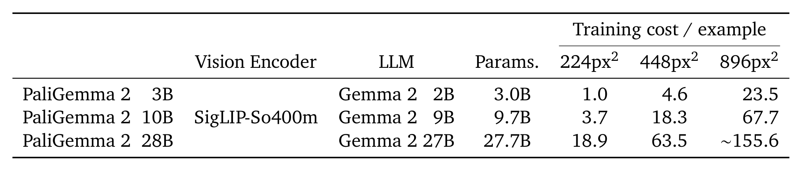
*Örnek başına göreceli eğitim maliyeti. 3B@896 (23.5), 28B@224'ten (18.9) daha pahalı. Kaynak: PaliGemma 2 (Steiner vd., 2024), Table 1. CC BY 4.0.*

## Asıl soru: göz mü, beyin mi?

Makalenin kalbi 4.1. bölümdeki deney. 3B, 10B ve 28B modellerin her biri 224 ve 448 pikselde, 30'dan fazla benchmark için fine-tune ediliyor. Bu benchmark'lar resim açıklama, soru-cevap, doküman anlama, nesne bulma ve video görevlerini kapsıyor. Her ayar 5 kez çalıştırılıp medyanı raporlanıyor. Bu sayede tek bir şanslı ya da şanssız çalıştırma sonucu değiştiremiyor.

Sonra 3B@224'ten başlanıp iki yöne gidiliyor: ya dil modeli büyütülüyor (3B → 10B, maliyet yaklaşık 3.7 kat) ya da çözünürlük artırılıyor (224 → 448, maliyet yaklaşık 4.6 kat). Her görev için iki yönde ne kadar kazanç olduğuna bakılıyor.

Çoğu görev iki yönden de kazanıyor. Ama kazançların dağılımı çok öğretici:

- **Göz isteyen görevler:** Metin, doküman, grafik ve ekran görüntüsü soruları (DocVQA, InfoVQA, ChartQA, TextVQA gibi). Bu görevlerde resimlerin kendisi zaten büyük ve ince detaylı. 224 piksele küçültülmüş bir faturadaki yazıyı okuyamayan bir modele daha büyük bir beyin vermek pek işe yaramıyor. Önce görmesi gerekiyor.
- **Beyin isteyen görevler:** Çok dilli açıklama (XM3600, 35 dil) ve akıl yürütme gerektiren görevler (bilimsel diyagram soruları AI2D, nesne sayma CountBench, iki resmi karşılaştırma NLVR2). Burada resmi daha keskin görmek değil, gördüğünü yorumlamak önemli.


*Makalenin kalbi: Yatay eksen 3B→10B (beyin), dikey eksen 224→448 px (göz) ile gelen göreceli iyileşme. Sarı: çözünürlükten, mavi: model boyutundan, yeşil: ikisinden de kazanan görevler. Kaynak: PaliGemma 2 (Steiner vd., 2024), Figure 3. CC BY 4.0.*

Yazarlar burada dürüst bir not da düşüyor: Bazı benchmark'lar neredeyse doymuş durumda. Örneğin ScienceQA'da %2.2'lik bir artış küçük görünüyor ama aslında hataların %53.8'inin ortadan kalkması demek. Skor zaten 100'e yakın olduğunda küçük bir artış bile büyük bir ilerleme olabiliyor.

### 10B tatlı nokta mı?

Model boyutuna dair ikinci bir ilginç bulgu var: **3B'den 10B'ye geçiş belirgin bir kazanç getiriyor, ama 10B'den 28B'ye geçiş çok az ya da hiç kazanç getirmiyor.** Oysa 28B'nin maliyeti 10B'nin yaklaşık beş katı.

Yazarların açıklaması şu: Gemma 2'nin 2B ve 9B modelleri daha büyük bir modelden damıtılarak (distillation) eğitilmiş, 27B modeli ise sıfırdan eğitilmiş. Yani küçük kardeşler büyük bir öğretmenden "özet" almış, 27B ise her şeyi kendi öğrenmiş. Bu mantıklı bir hipotez ama test edilmemiş. Pratikte bu, 10B'nin fiyat/performans açısından "tatlı nokta" olduğunu düşündürüyor.

Aynı boyutta Gemma 1'den Gemma 2'ye geçişin etkisi ise beklenenden küçük: 30'dan fazla benchmark'ın ortalamasında 224 pikselde +0.65, 448 pikselde +0.85 puan. Yani PaliGemma 2'nin asıl kazancı daha iyi bir dil modelinden değil, **daha büyük** dil modeli seçeneklerinden geliyor.

### Büyük model, küçük adım

Son bulgu learning rate ile ilgili. Makale her görev ve her model boyutu için 7 farklı learning rate deniyor ve sonuçları ısı haritası olarak gösteriyor. Haritalarda diyagonal bir desen var: Model büyüdükçe en iyi learning rate küçülüyor. Sezgisel olarak bu mantıklı. Büyük bir model zaten çok şey biliyor ve fine-tuning sırasında büyük adımlar atmak bu bilgiyi bozabiliyor. Kendi modelini fine-tune edecek biri için bu, doğrudan uygulanabilir bir tavsiye: **Modeli büyüttüyseniz daha küçük learning rate'leri de deneyin.**

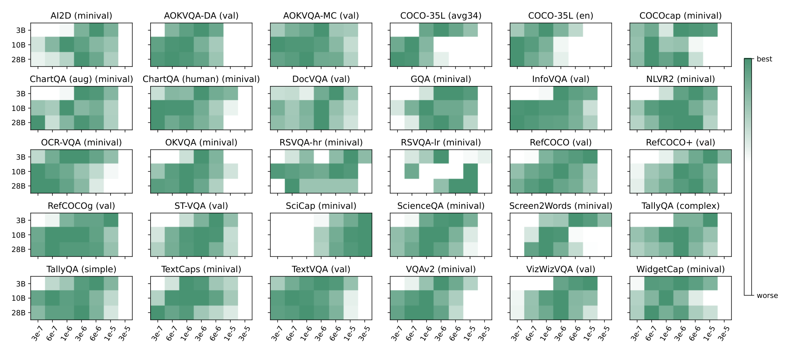
*Her görev ve model boyutu için learning rate taraması. Koyu renk daha iyi. Büyük modellerde koyu bölge sola, küçük learning rate'lere kayıyor. Kaynak: PaliGemma 2 (Steiner vd., 2024), Figure 5. CC BY 4.0.*

## Yeni alanlarda bir tur

Makalenin ikinci yarısı PaliGemma 2'yi daha önce denenmemiş görevlere uyguluyor. Bu bölümün ana mesajı şu: **Göreve özel bir mimari yok. Genel bir VLM, sadece fine-tune edilerek birçok alanda en iyi sonuca (SOTA) ulaşıyor.** Her görev için aynı soruları soracağım: Görev ne, nasıl ölçülüyor, sonuç ne ve neye dikkat etmek gerekiyor?


### Metin tanıma (OCR)

Resimdeki her kelimeyi bulmak ve okumak. Çıktı, her kelime için bir {metin, kutu} çifti. Değerlendirme çok katı: Bir kelimenin doğru sayılması için kutunun gerçek kutuyla en az %50 örtüşmesi (IoU ≥ 0.5) ve metnin büyük/küçük harf ve noktalama dahil birebir aynı olması gerekiyor.

3B@896 model, OCR için özel tasarlanmış HTS modelini iki benchmark'ta da geçiyor: ICDAR'15'te F1 75.9'a karşı 74.5, Total-Text'te 74.2'ye karşı 72.4. Yalnız fark küçük ve Total-Text'te precision'da HTS hâlâ önde (75.7'ye karşı 73.8). Yani PaliGemma 2'nin kazancı daha fazla kelime bulmasından (recall) geliyor.

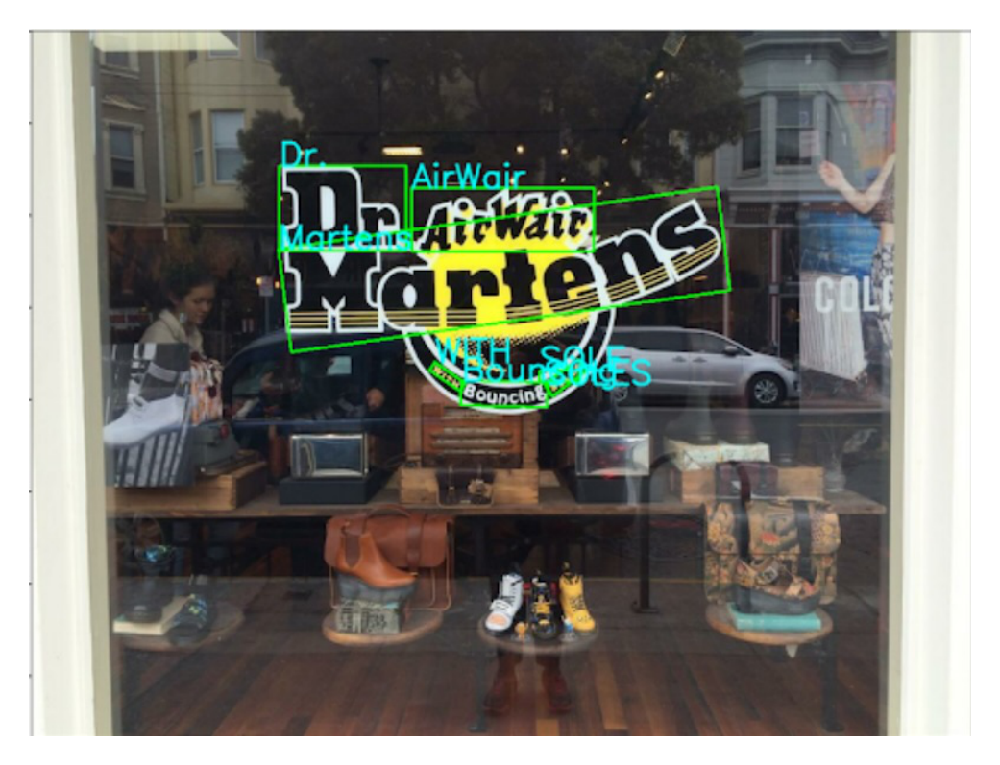
*Total-Text test setinden bir örnek: 3B@896 modelinin bulduğu kelime kutuları. Kaynak: PaliGemma 2 (Steiner vd., 2024), Figure 6. CC BY 4.0.*

### Tablo yapısı tanıma

Bir tablo resminden satırları, sütunları, birleştirilmiş hücreleri, hücre metinlerini ve hücre kutularını çıkarmak. Model bunların hepsini tek bir **HTML** çıktısı olarak yazıyor. Hücre kutuları da yine `<loc>` tokenları ile HTML'in içine gömülüyor. Tablolar uzun olduğu için çıktı uzunluğu 4.096 tokena çıkarılmış.

Ölçüm için iki metrik ailesi kullanılıyor: TEDS (tablonun HTML ağacı ne kadar doğru) ve GriTS (hücre yapısı ve içerikleri ne kadar doğru). 3B@896 model, finansal tablolardan oluşan FinTabNet'te dört metrikte de, bilimsel makale tablolarından oluşan PubTabNet'te ise çoğu metrikte yeni SOTA'ya ulaşıyor.

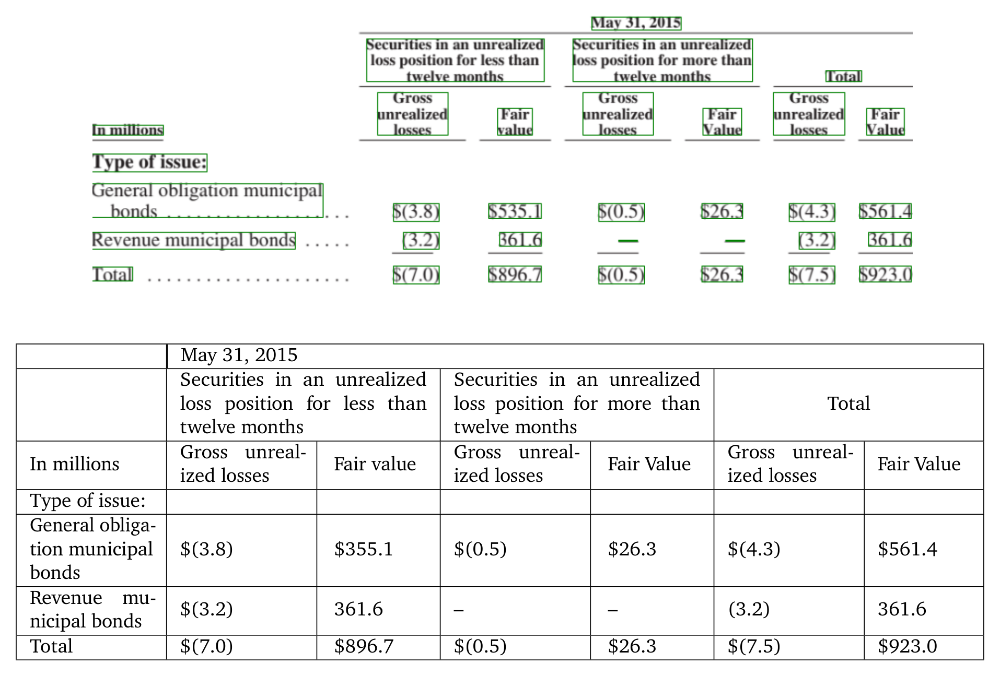
*Üstte FinTabNet'ten orijinal tablo ve tahmin edilen hücre kutuları (yeşil), altta modelin ürettiği HTML'in görüntüsü. Kaynak: PaliGemma 2 (Steiner vd., 2024), Figure 7. CC BY 4.0.*

### Molekül tanıma

Bir molekül çizimine bakıp onu **SMILES** formatına çevirmek. SMILES, bir molekülün atomlarını ve bağlarını tek satırlık bir metin olarak yazmanın standart yolu. Model PubChem'den alınan 1 milyon molekül çizimiyle eğitiliyor ve ChemDraw ile çizilmiş 5.700 resim üzerinde test ediliyor.

Ölçüt tam eşleşme: Üretilen molekül ile gerçeği birebir aynı mı? 10B@448 model, bu alanın en iyi modeli MolScribe'ı geçiyor (%94.8'e karşı %93.8). Bu, OCR ve tablolardan farklı olarak yüksek çözünürlüğün değil büyük modelin öne çıktığı ilk görev. Yalnız test verisi de tamamen sentetik. Gerçek bir makaleden kesilmiş, taranmış bir molekül çiziminde sonuç ne olurdu, bilmiyoruz.

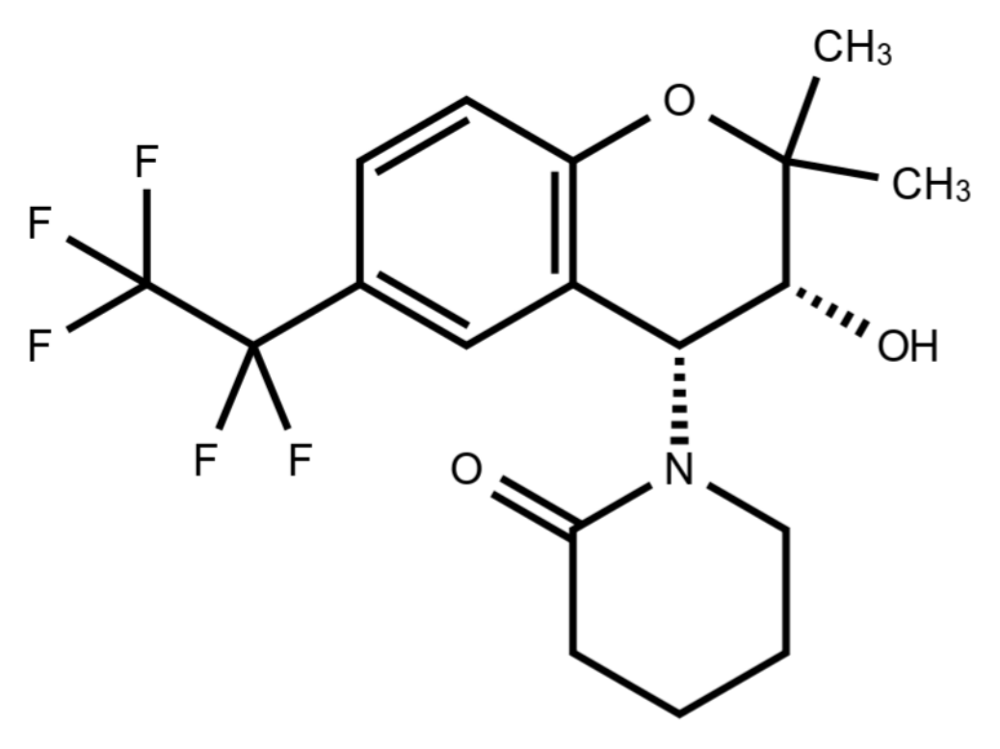
*Bir molekül çizimi. Modelin görevi bunu tek satırlık bir SMILES dizisine çevirmek. Kaynak: PaliGemma 2 (Steiner vd., 2024), Figure 8. CC BY 4.0.*

### Nota okuma

Bir nota kağıdının resmini dijital nota formatı olan **\*\*kern**'e çevirmek. **kern, her notanın perdesini, süresini, artikülasyon işaretlerini ve ölçü çizgilerini düz metin olarak yazıyor. GrandStaff veri setindeki yaklaşık 54 bin piyano notası üzerinde çalışılıyor.

Üç hata oranı ölçülüyor: karakter (CER), sembol (SER) ve satır (LER) düzeyinde. En katısı satır hatası. 3B@896 model, önceki en iyi model Sheet Music Transformer'ın hatalarını yarıdan fazla azaltıyor: CER 3.9'dan 1.6'ya, SER 5.1'den 2.3'e, LER 13.1'den 6.7'ye iniyor. Yalnız deney sadece **tek satırlık** notalarla yapılmış. Gerçek bir nota sayfasında birçok satır var ve tam sayfa denenmemiş.

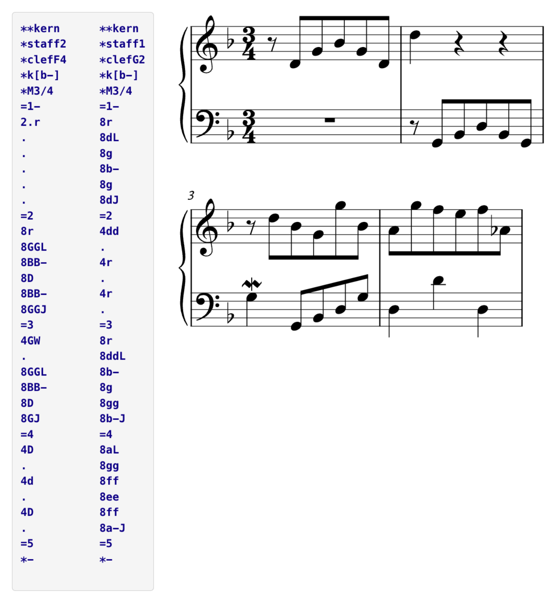
*Solda **kern metni, sağda karşılık gelen piyano notası. Kaynak: PaliGemma 2 (Steiner vd., 2024), Figure 9 (kaynak: humdrum.org). CC BY 4.0.*

### Uzun ve detaylı açıklama

Bir resim için "bir at duruyor" gibi kısa bir cümle değil, 7-8 cümlelik ayrıntılı bir paragraf yazmak. Bu yetenek, Stable Diffusion gibi metinden resim üreten modellerin eğitimi için çok değerli. Açıklama ne kadar ayrıntılı olursa, üretilen resim o kadar kontrol edilebilir oluyor. Model, insanların yazdığı 15 bin detaylı açıklama içeren DOCCI veri setiyle eğitiliyor.

Burada ölçüm otomatik değil, insanlar yapıyor. Üretilen her cümle ayrı ayrı gösteriliyor ve beş kişiye "bu cümle resimle uyuşuyor mu?" diye soruluyor. Resimle uyuşmayan ya da resimden doğrulanamayan cümlelerin oranı **NES** olarak raporlanıyor. Kısaca, modelin uydurma oranı. Düşük olması iyi.

PaliGemma 2 10B, %20.3 ile tablodaki en iyi sonucu alıyor. 3B boyutunda PaliGemma 1'in oranı %34.3, PaliGemma 2'nin %28.4; LLaVA-1.5'in %40.6, MiniGPT-4'ün ise %52.3. Açıklama uzunlukları birbirine yakın, yani PaliGemma 2 daha kısa yazdığı için daha az hata yapıyor değil. Makalenin ekindeki at örneği çok öğretici: Bazı modeller "güneş ışığında parlayan tüyler" ya da "hafifçe sallanan kuyruk" gibi fotoğraftan doğrulanması imkânsız süslemeler ekliyor.

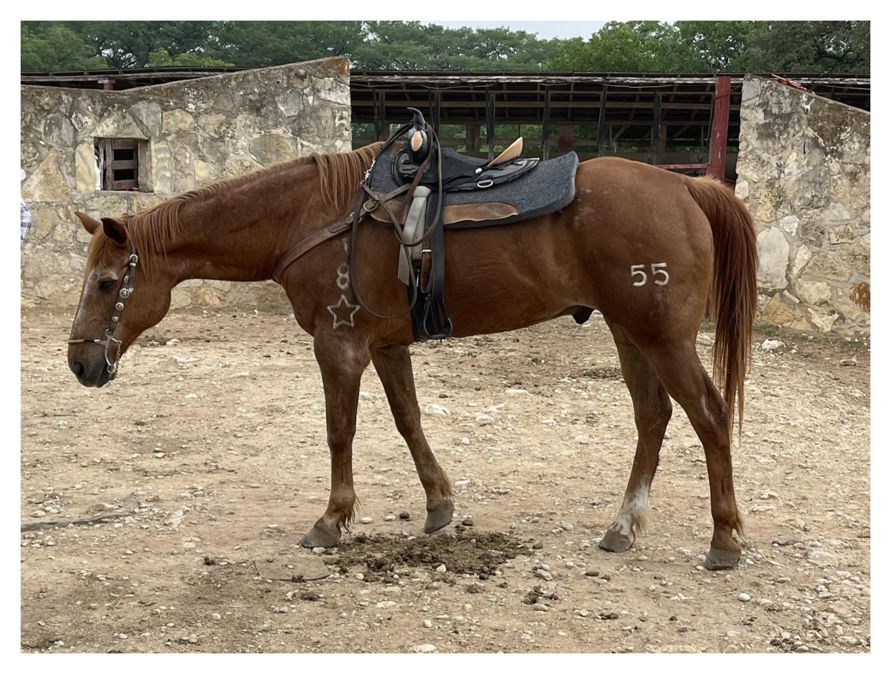
*DOCCI'den örnek resim. Modellerin bu at için yazdığı açıklamalar makalenin ekinde, uydurma cümleler kırmızıyla işaretli. Kaynak: PaliGemma 2 (Steiner vd., 2024), Figure 10. CC BY 4.0.*

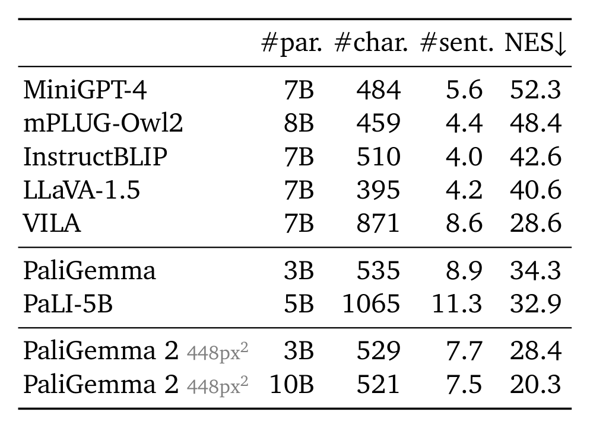
*DOCCI'de uydurma cümle oranı (NES, düşük daha iyi). Sadece Pali ailesi bu veri setinde fine-tune edilmiş. Kaynak: PaliGemma 2 (Steiner vd., 2024), Table 6. CC BY 4.0.*

Bu görevde 3B'den 10B'ye geçince uydurma oranı 28.4'ten 20.3'e düşüyor. OCR'ın tersine, uzun ve tutarlı bir metin yazmak beyne daha çok iş düşürüyor.

### Uzamsal akıl yürütme

Modele bir resim ve "kedi kanepenin solunda" gibi bir cümle veriliyor. Model bu cümlenin doğru mu yanlış mı olduğunu söylüyor. PaliGemma'da her şey metin olduğu için cevabı "True" ya da "False" olarak yazıyor. Kullanılan VSR benchmark'ı iki farklı şekilde test ediyor: rastgele bölünmüş bir test seti ve testteki nesnelerin eğitimde hiç görülmediği daha zor bir set.

Burada da beyin kazanıyor. 3B'den 10B'ye geçince iki test setinde de yaklaşık 5 puanlık artış var: zor sette 74.8'den 79.8'e, rastgele sette 81.6'dan 86.8'e. Çözünürlüğü 224'ün üstüne çıkarmak ise işe yaramamış. Yine de insan performansıyla arada hâlâ yaklaşık 15 puanlık bir fark var (95.4).

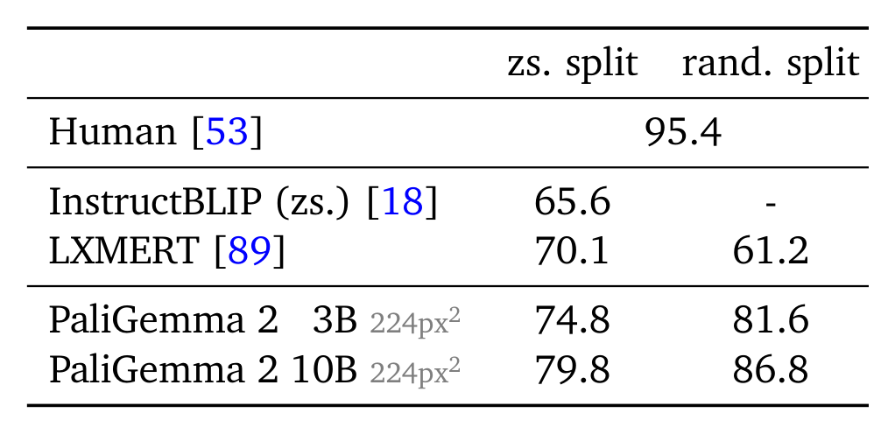
*VSR doğruluğu. 3B→10B her iki test setinde yaklaşık 5 puan kazandırıyor, insanla arada hâlâ fark var. Kaynak: PaliGemma 2 (Steiner vd., 2024), Table 7. CC BY 4.0.*

### Röntgen raporu

Göğüs röntgenine bakıp radyoloğun yazacağı raporu üretmek. Makale bunu "röntgen üzerinde uzun açıklama" olarak ele alıyor. Model tek bir hastaneden gelen 377 bin röntgen ve raporla (MIMIC-CXR) eğitiliyor. Modele röntgenin neden çekildiği (ör. "nefes darlığı, ödem şüphesi") hazır olarak veriliyor. Model bulguları ve yorumu yazıyor, tıpkı gerçek klinikteki gibi.

Güzel bir detay var: Raporlarda sık sık "önceki röntgene göre kötüleşmiş" gibi ifadeler geçiyor. Model önceki röntgeni görmediği için bu ifadeleri öğrenirse uydurmak zorunda kalır. Bu yüzden bu ifadeler Gemini 1.5 Pro ile raporlardan temizlenmiş.

Ölçüt RadGraph F1: Üretilen rapordaki ve gerçek rapordaki tıbbi bulgular ("plevral efüzyon: var", "ödem: yok" gibi) çıkarılıp karşılaştırılıyor. PaliGemma 2 10B@896, 29.5 ile SOTA'ya ulaşıyor ve tıbba özel Med-Gemini modelini (24.4) geçiyor. Bu, OCR bölümündeki mesajın tıptaki karşılığı.

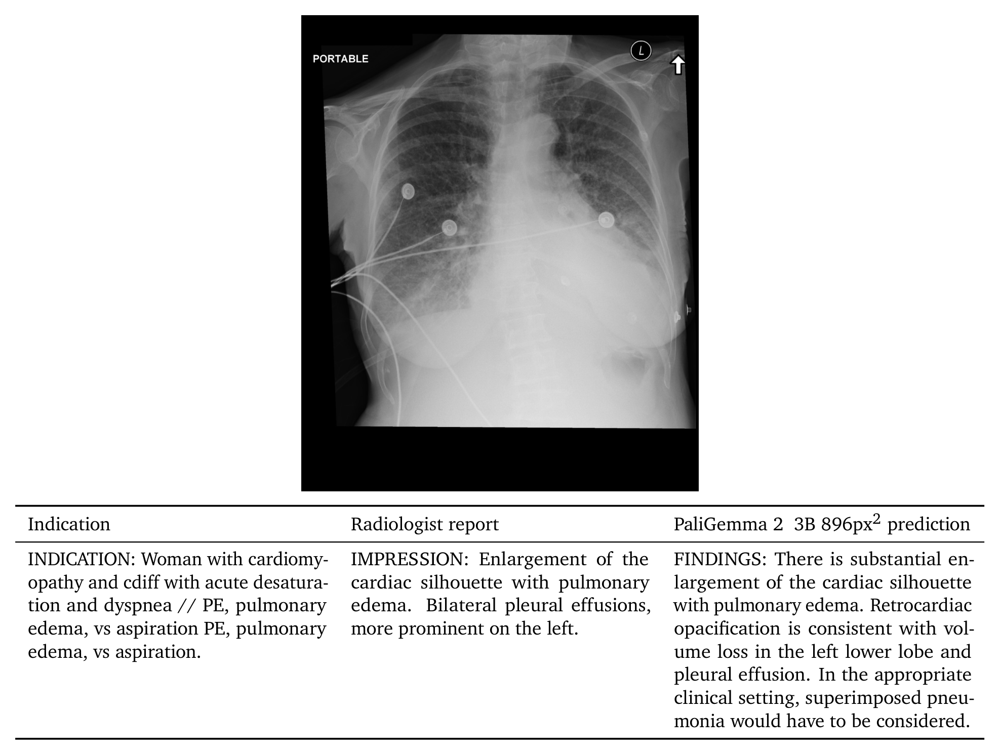
*MIMIC-CXR'den bir örnek: klinik gerekçe (indication), radyoloğun raporu ve PaliGemma 2 3B@896'nın tahmini. Kaynak: PaliGemma 2 (Steiner vd., 2024), Figure 11. CC BY 4.0.*

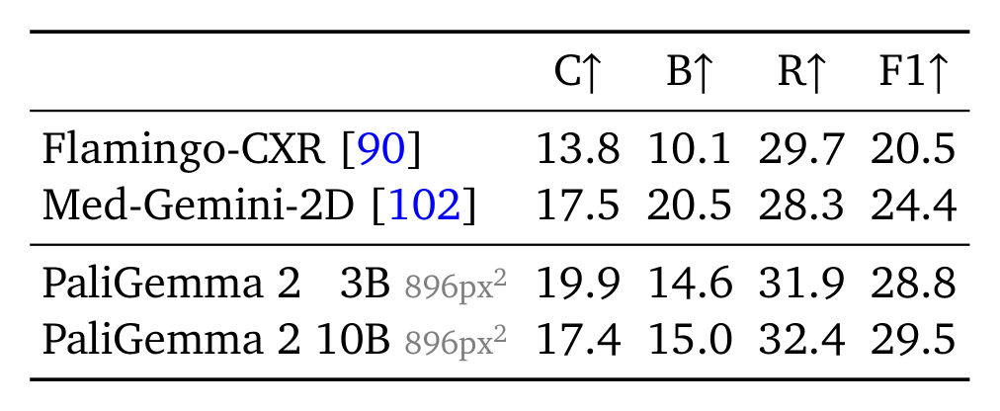
*Röntgen raporu sonuçları. Son sütun klinik metrik RadGraph F1. Kaynak: PaliGemma 2 (Steiner vd., 2024), Table 8. CC BY 4.0.*

### Laptopta çalışır mı?

Son olarak model hiçbir hızlandırıcı olmadan, sadece CPU ile çalıştırılıyor. 8-bit quantization ile modelin bellekteki boyutu 12.1GB'tan 4GB'a iniyor. Kalite ise pratikte hiç değişmiyor: Beş farklı görevde sonuçlar orijinalin %99.9-100.2'si arasında.

Hız donanıma göre çok değişiyor. Bir M1 Max laptopta bir resmi açıklamak yaklaşık 10 saniye sürüyor ve bu sürenin büyük kısmı prefill'e, yani 260 tokenı okumaya gidiyor. 32 çekirdekli bir AMD sunucu işlemcisinde ise süre yaklaşık 1.2 saniyeye iniyor.

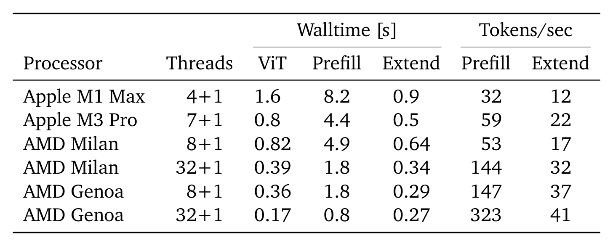
*Farklı işlemcilerde sadece CPU ile çıkarım süreleri (3B@224). Sürenin çoğu prefill'e gidiyor. Kaynak: PaliGemma 2 (Steiner vd., 2024), Table 9. CC BY 4.0.*

### Tabloyu yan yana koyunca

Bu yedi görevi yan yana koyunca 4.1'deki göz/beyin ayrımı yeniden ortaya çıkıyor. Makale bunu kendisi toparlamıyor ama tablo açık: **OCR, tablo ve nota** gibi ince görsel detay isteyen görevlerde en iyi ayar **3B@896**. **Molekül, uzun açıklama ve uzamsal akıl yürütme** gibi yorum isteyen görevlerde ise **10B** öne çıkıyor. Röntgende ikisi de biraz katkı sağlıyor.

## Ben de denedim: Türkçe tabelalar, fişler, iki çözünürlük

Makaleyi okurken en çok "söylüyorlar ama göstermiyorlar" diye şikâyet ettim. Ama model açık ağırlıklı, yani bir kısmını kendim test edebilirim. Ücretsiz Google Colab'ın T4 GPU'sunda 3B modelin iki sürümünü çalıştırdım: **mix-224** ve **mix-448**. İkisi de aynı beyne sahip, sadece göz farklı. 10B ve 28B ücretsiz GPU'ya sığmadığı için "beyin" tarafını deneyemedim.

Bir not: "mix" sürümler birçok görevin karışımıyla fine-tune edilmiş, kutudan çıktığı gibi kullanılabilen modeller. Makaledeki gibi her göreve ayrı fine-tune etmedim. Bu yüzden rakamlarım makaledekilerle birebir kıyaslanamaz. Benim baktığım şey aynı model ailesi içindeki **yön**.

**Ne denedim?** Wikimedia Commons'tan Türkiye'de çekilmiş, açık lisanslı **41 fotoğraf** topladım: sokak levhaları, "Acil Çıkış" ve "Sigara İçilmez" tabelaları, balık tezgâhındaki el yazısı fiyatlar, kuruyemiş etiketleri, Galata Kulesi'ndeki kitabe. Bunlar için **54 soru** yazdım ve doğru cevapları kendim belirledim. Her soruyu hem Türkçe hem İngilizce sordum. Soruları, yazının fotoğrafta büyük mü yoksa küçük mü olduğuna göre de ayırdım. Bunlara ek olarak 11 tabelada tam metin okuma (`ocr`) ve CORD veri setinden **50 fişte** "toplam tutar ne?" sorusu var. Puanlamayı iki türlü yaptım. Katı puanda Türkçe harfler birebir doğru olmalı ("türkü" ≠ "turku"). Esnek puanda bu harf farkları görmezden geliniyor.

### Göz farkı ince ayrıntıda açılıyor


*224 ve 448 pikselde aynı 3B model. Ölçüm ve görsel: yazar.*

Büyük tabela yazılarında iki model birbirine yakın (%45'e karşı %52). Mahalle adı, mesafe ya da kanun numarası gibi küçük yazılarda ise 224 neredeyse hiç okuyamıyor (%13), 448 üç kat daha iyi (%39). En net sonuç fişlerde: toplam tutarı 224 fişlerin %46'sında, 448 ise %84'ünde doğru buldu. 448'in doğru, 224'ün yanlış bildiği 23 fiş var. Tersi sadece 2. Bu fark şansla açıklanamayacak kadar büyük.

Bu, makalenin 4.1. bölümdeki "metin okuyan görevler göz ister" bulgusunun, makalenin hiç bakmadığı bir veride, yani Türkçe sokak tabelalarında da geçerli olduğunu gösteriyor. Bedeli de var: Soru başına süre 0,9 saniyeden 3,1 saniyeye çıkıyor.

### Okuyamayınca uyduruyor

Beni en çok şaşırtan, yüzdeler değil yanlışların türü oldu. 224 bir yazıyı okuyamadığında "bilmiyorum" demiyor, akıcı ve inandırıcı bir şey uyduruyor.


*Galata Kulesi kitabesi, iki modelin `ocr` çıktısı. Fotoğraf: Wikimedia Commons, kamu malı. Görsel: yazar.*

Kitabedeki "29 Mayıs 1453 Salı sabahı" ifadesi 224'te **"20 Mayıs 1938 Salih sabahi"** olmuş. Dernek adı da "Çankaya Belediye"ye dönüşmüş. "Aydın Büyükşehir Belediyesi" yazan levhayı "Kızılay Belediyesi" diye okudu. Sigara tabelasına görselde olmayan bir cümle ekledi: "Sigara içenler uyarıdan ötekileşirler." İstanbul'daki yön tabelasında Londra'ya 895 km dedi (doğrusu 2.502). 448 aynı kitabeyi iki harf hatasıyla okudu.

448 de tamamen kusursuz değil. Bir sokak levhasını okurken aynı satırları tekrar tekrar yazdı, bir tabelaya da olmayan bir "Türkiye Cumhuriyeti" ekledi. Yine de fark açık: Göz yetersiz kaldığında model boşluğu dil bilgisiyle dolduruyor. Bu bence yüzdelerden daha önemli bir uyarı. Yanlış cevap, doğru cevap kadar emin görünüyor.

### Türkçe: soruyu Türkçe sorun, harflere güvenmeyin

Beklemediğim bir sonuç: **Türkçe sorular İngilizcelerden daha iyi sonuç verdi** (448'de %46'ya karşı %37). Cevaplara bakınca iki sebep çıktı. Birincisi, İngilizce sorunca model cevabı çeviriyor: "Burada ne yasak?" sorusuna Türkçe sorunca "sigara", İngilizce sorunca "smoking" diyor. 224 alabalık etiketine İngilizce soruda "alabama" bile dedi. İkincisi, İngilizce soruda daha kolay pes ediyor. 448 "cevaplanamaz" cevabını İngilizce sorularda 5, Türkçe sorularda 2 kez verdi.

Türkçe harflerde ise ilginç bir ayrım var. `ocr` komutunda 448 Türkçe harflerin %94'ünü doğru yazıyor. Ama soruya cevap verirken aynı harfleri düşürüyor: "acil cikis", "cinarcik", "daghan", "bayat ekmek askisi". Metni doğru bulduğu 14 Türkçe-harfli cevabın sadece 3'ünde harfler de doğru. Yani model harfleri görüyor ama cevap yazarken kullanmıyor. Benim tahminim, soru-cevap eğitim verisindeki cevapların İngilizce harflere indirgenmiş olması. Ama bunu test etmedim.

Türkçe resim açıklamaları da zayıf. Hamsi kovası için Türkçe açıklama istedim, cevap İngilizce ve yanlış geldi: "Invertebrate food is for sale in a red bucket" ("Kırmızı kovada omurgasız yiyecek satılıyor"). Aynı resmin İngilizce açıklaması ise etiketi bile okuyordu: "hamsi 4 mtl". Makale çok dilli açıklamayı "beyin isteyen" görevler arasında sayıyordu. 3B'nin Türkçede bocalaması buna uyuyor. Ama 10B'yi deneyemediğim için bu bir doğrulama değil, sadece uyumlu bir gözlem.

### Bu deneyin sınırları

54 soruda her soru yaklaşık 2 puan ediyor. Bu yüzden tabelalardaki birkaç puanlık farklar kesin değil. Fiş sonucu ise (50 fişte 23'e karşı 2) sağlam. Soruları ve doğru cevapları ben yazdım, dolayısıyla seçimlerim sonucu etkilemiş olabilir. Katı puanlamam da modele karşı biraz acımasız: 448'in Türkçe sorulardaki başarısı katı puanla %46, harf farkını görmezden gelince %67. Notebook ve veri seti burada: [Colab notebook](https://colab.research.google.com/drive/1wL1xt4rzYNZ8w3tCMfDH7slQWwOQ7ezJ). Herkes aynı deneyi tekrarlayabilir.

## Beni ikna eden ve etmeyen noktalar

### İkna eden

- **Göz/beyin ayrımı sağlam.** Aynı tarifle eğitilmiş modeller, 30'dan fazla benchmark, 5 tekrar ve standart sapma var. Yazarlar ScienceQA gibi doygunluğa ulaşmış benchmark'ları da kendileri belirtmişler. Makalenin en güvenilir bulgusu bu.
- **"Her şey metin" yaklaşımı çalışıyor.** Aynı mimarinin tablo, molekül, nota ve röntgen gibi birbirinden bu kadar farklı alanlarda, alana özel modellerle yarışabilmesi etkileyici.
- **Quantization sonuçları net.** Beş farklı görevde kalite neredeyse birebir korunuyor. Açık bir model için bu çok pratik bir bilgi.
- **Röntgen deneyinde veri disiplini iyi.** Train/test bölümü önceki çalışmalarla aynı ve test verisinin eğitim ve ayar sırasında hiç kullanılmadığı açıkça yazılmış.

### İkna etmeyen

**1. Söylüyorlar ama göstermiyorlar.** Makaleyi okurken en çok takıldığım nokta bu oldu. Yeni görevlerin neredeyse hepsinde "çözünürlüğü düşürünce kötüleşti" ya da "modeli büyütmek işe yaramadı" deniyor, ama bunun rakamları verilmiyor. OCR'da model büyütmenin işe yaramadığı söyleniyor, rakam yok. Molekülde neden 10B'nin seçildiği, 3B'nin ne kadar geride kaldığı belli değil. Uzun açıklamada "çözünürlük de iyileştiriyor" deniyor ama tabloda sadece 448 piksel var. Makalenin ana iddiası tam olarak bu soru hakkında olduğu için bu eksiklik daha da göze batıyor.


*"Söylendi mi, gösterildi mi?" Yeni görevlerde çözünürlük ve model boyutu karşılaştırmalarının hangilerinin rakamla desteklendiği. Analiz ve görsel: yazar.*

**2. 28B neredeyse hiç görünmüyor.** 4.1'de 10B'den 28B'ye kazanç az çıktı. Sonuç bölümü ise "büyük varyantlar ciddi iyileşme getiriyor" diyor. Yeni görevlerin hiçbirinde 28B sonucu yok. Özellikle 3B'den 10B'ye büyük bir sıçramanın görüldüğü uzun açıklama ve uzamsal akıl yürütme görevlerinde 28B'nin sonucunu görmek çok öğretici olurdu.

**3. Göz/beyin karşılaştırması eşit maliyetli değil.** Çözünürlük artışının maliyeti yaklaşık 4.6 kat, model büyütmenin maliyeti 3.7 kat. Yani çözünürlük tarafına yaklaşık %25 daha fazla bütçe verilmiş. Ayrıca learning rate sadece 224 pikselde seçilip 448'e aynen taşınmış. Bu, yüksek çözünürlüğü dezavantajlı bırakmış olabilir. 896 piksel ise bu analize hiç dahil edilmemiş. Bir görevin hangi gruba girdiğinin eşiği de net değil.

**4. Bazı karşılaştırmalar adil değil.** Uzun açıklama görevinde PaliGemma 2 bu veri setinde fine-tune edilmişken LLaVA, VILA gibi rakipler hiç eğitilmeden test edilmiş. Adil olan tek karşılaştırma PaliGemma 1 ile PaliGemma 2 arasındaki (%34.3'e karşı %28.4). Üstelik en iyi model 100 resimlik bir set üzerinde insan değerlendirmesiyle seçilmiş ve sonuç da aynı set üzerinde raporlanmış. Uzamsal akıl yürütmede fine-tune edilmiş tek rakip 2019 tarihli LXMERT. Ek'te bu görev için yaklaşık 216 farklı hiperparametre kombinasyonu denendiği görülüyor, ama en iyisinin hangi veri üzerinde seçildiği yazılmamış.

**5. Tıpta insan değerlendirmesi yok.** Röntgen raporları sadece otomatik metriklerle ölçülmüş, hiçbir radyolog değerlendirmemiş. Uzun açıklama görevinde insan değerlendirmesi yapılmışken, bunun çok daha kritik olduğu tıbbi görevde yapılmamış olması ironik. RadGraph F1'in 29.5 olması da tıbbi bulguların büyük kısmının hâlâ tutmadığı anlamına geliyor. Veri tek bir hastaneden geliyor. Gemini ile yapılan temizliğin test raporlarına da uygulanıp uygulanmadığı belirtilmemiş. Uygulandıysa, rakip modellerin sonuçları farklı referanslar üzerinden hesaplanmış olabilir.

**6. Tek çalıştırma, standart sapma yok.** 4.1'deki özenli 5 tekrarlı deney, yeni görevlerde bırakılmış. OCR'daki 1.5-2 puanlık fark gibi küçük farkların gerçek mi yoksa şans mı olduğunu bilemiyoruz.

### Eksik gördüğüm deneyler

Makaleyi okurken görmek istediğim deneyleri şöyle sıralayabilirim:

- **Eşit maliyetli karşılaştırma:** Aynı hesaplama bütçesiyle "göz mü, beyin mi?"
- **Her yeni görev için tam 3×3 tablo:** 3 boyut × 3 çözünürlük. Rakamlar muhtemelen zaten mevcut, sadece yayımlanmamış.
- **28B'nin neden az kazandığının testi:** Damıtma hipotezi, örneğin damıtılmış bir 27B ile test edilebilir.
- **Gözü de büyütmek:** Makale sadece dil modelini büyütüyor. Daha büyük bir görüntü kodlayıcının etkisi hiç denenmemiş.
- **Gerçek dünya verisi:** Taranmış molekül çizimleri, tam sayfa nota kağıtları, farklı hastanelerden röntgenler.
- **Radyologların değerlendirmesi:** Raporların klinikte kullanılabilir olup olmadığı.
- **896 pikselde ve uzun çıktılarda CPU hızı:** Çünkü makalenin en iyi sonuçları tam da bu ayarlardan geliyor. 4.096 görsel token ile prefill süresi yaklaşık 16 kat uzar.

## Sonuç

PaliGemma 2 mimari olarak yeni bir şey önermiyor. Ama kontrollü bir model ailesi sunarak önemli ve pratik bir soruya cevap veriyor: **Modelinize göz mü, beyin mi eklemelisiniz?** Cevap göreve göre değişiyor. İnce görsel detay istiyorsanız çözünürlüğe, yorum istiyorsanız daha büyük bir dil modeline yatırım yapın. Çoğu durumda 10B tatlı nokta gibi görünüyor. Modeli büyüttüğünüzde learning rate'i küçültmeyi de unutmayın.

Makalenin bence en kalıcı fikri ise "her şey metin" yaklaşımı. Kutular, maskeler, tablolar, moleküller, notalar ve tıbbi raporlar aynı mimariyle, sadece farklı bir çıktı diliyle çözülebiliyor.

Öte yandan makale, sonunda bir analiz çalışmasından çok bir model tanıtım raporu gibi kapanıyor. Girişteki iki ana bulgu sonuç bölümünde tekrar edilmiyor, sınırlılıklar hiç tartışılmıyor, yeni görevlerdeki boyut ve çözünürlük iddiaları da rakamlarla desteklenmiyor. Açık ağırlıklı modeller sayesinde bu eksik deneylerin bir kısmını topluluğun kendisi yapabilir. Belki de makalenin asıl daveti bu. Ben bu daveti küçük ölçekte kabul ettim. Türkçe tabelalarda göz farkı makalenin söylediği gibi çıktı. Ama asıl ders başka çıktı: Küçük göz, okuyamadığı yerde uyduruyor. Model Türkçe harfleri görüyor ama cevap yazarken düşürüyor.

---

**Kaynak:** Steiner, A., Pinto, A. S., Tschannen, M., et al. (2024). *PaliGemma 2: A Family of Versatile VLMs for Transfer.* arXiv:2412.03555. [arxiv.org/abs/2412.03555](https://arxiv.org/abs/2412.03555)

**İleri okuma:**
- [Introducing PaliGemma 2 — Google Developers Blog](https://developers.googleblog.com/en/introducing-paligemma-2-powerful-vision-language-models-simple-fine-tuning/)
- [Welcome PaliGemma 2 — Hugging Face Blog](https://huggingface.co/blog/paligemma2)
- [PaliGemma 2 model ağırlıkları — Hugging Face](https://huggingface.co/collections/google/paligemma-2-release)
