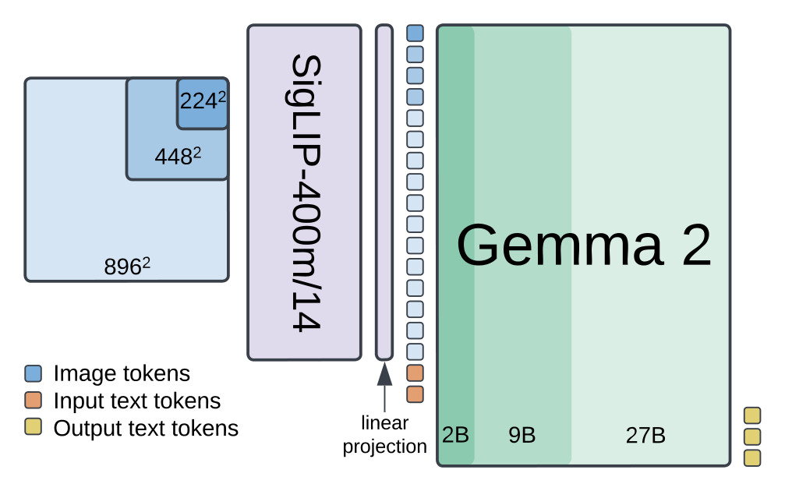
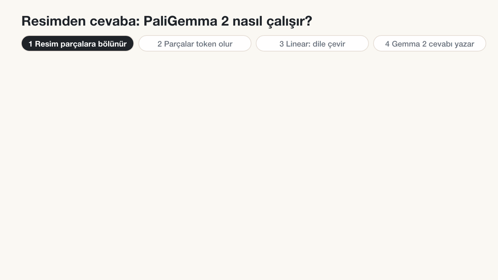
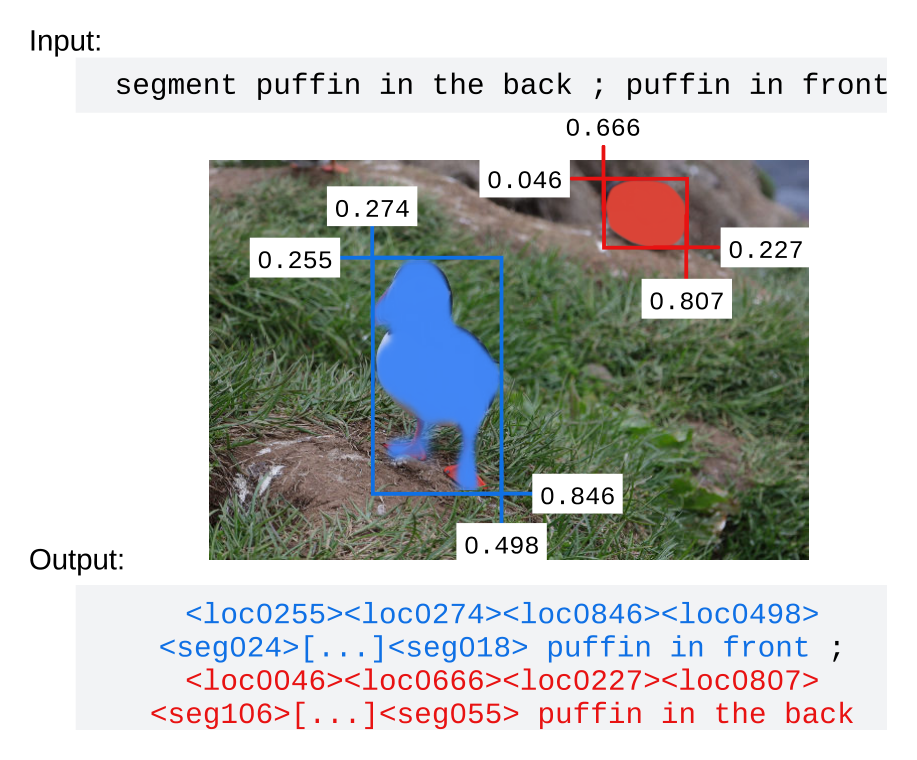
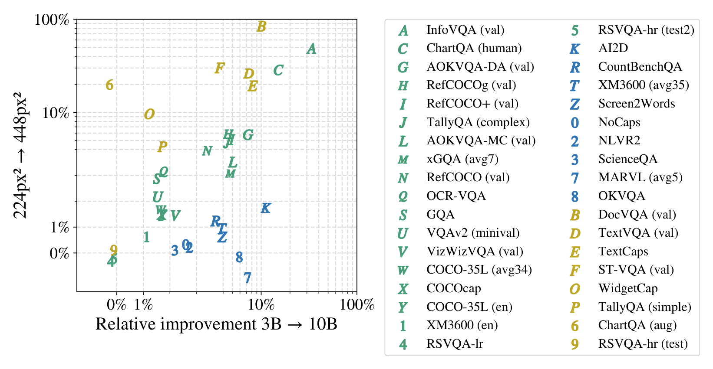
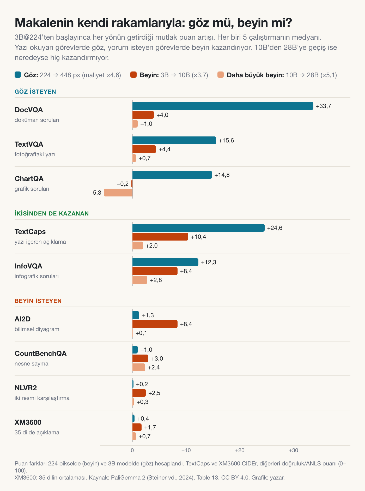
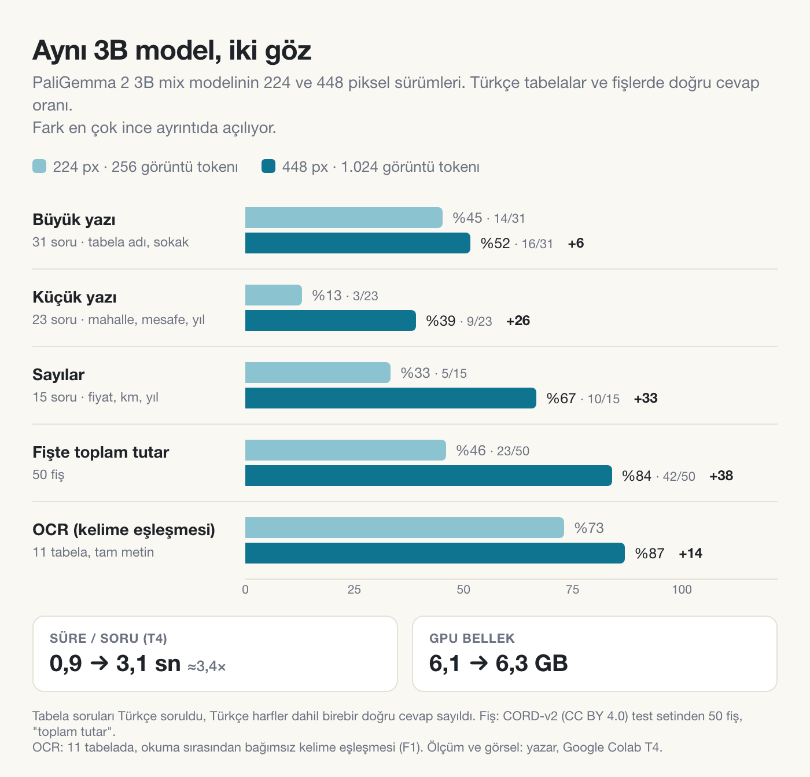
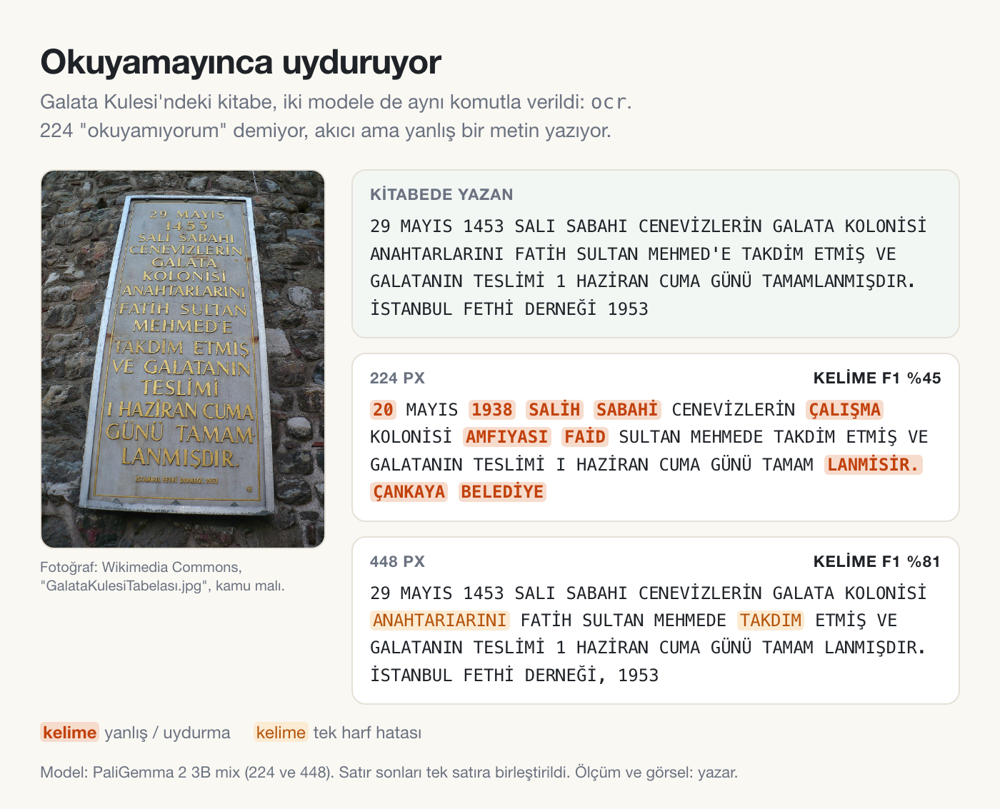
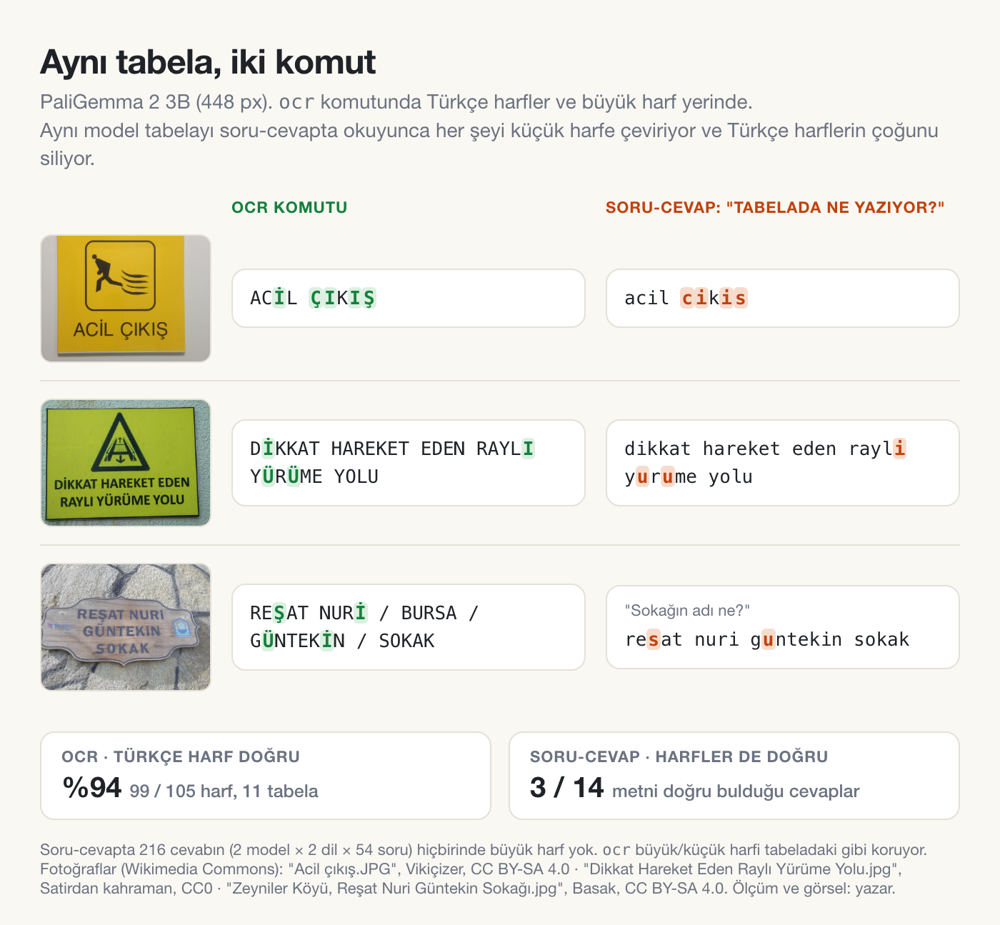
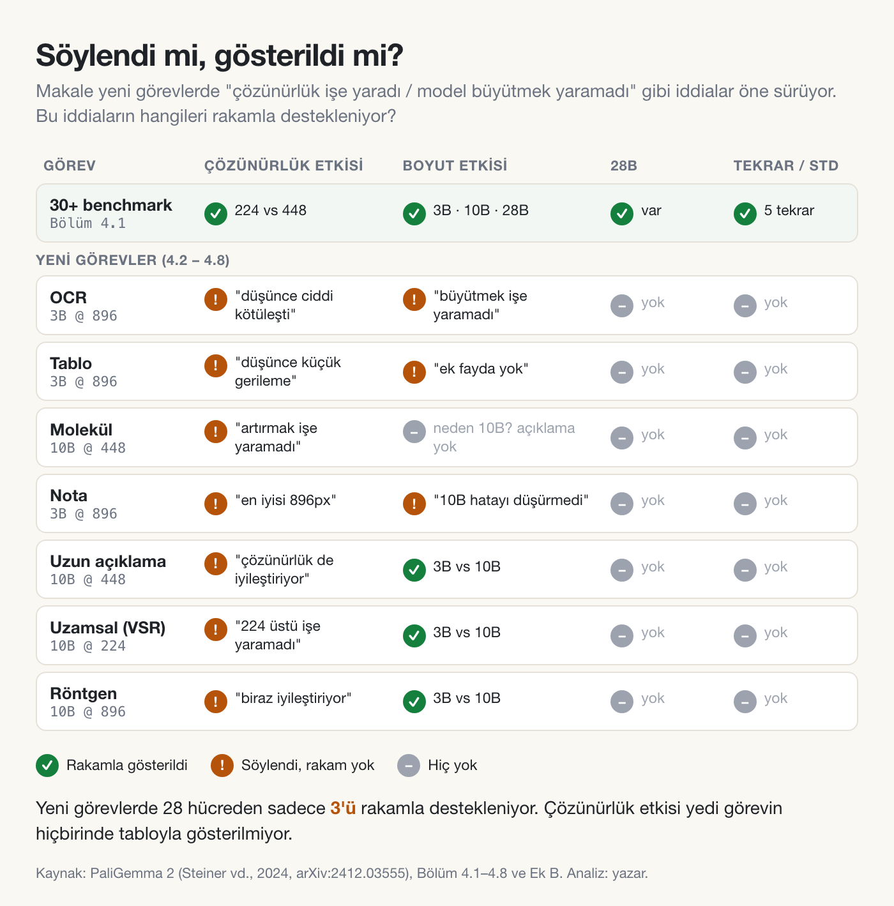

# Göz mü, Beyin mi? Bir Görsel-Dil Modeline Nereden Yatırım Yapmalı?

### PaliGemma 2 makalesi ve ücretsiz GPU'da küçük bir deney


*PaliGemma 2 mimarisi: SigLIP görüntü kodlayıcı, linear projection ve üç boyutta Gemma 2. Resim çözünürlüğü 224, 448 veya 896 piksel. Kaynak: PaliGemma 2 (Steiner vd., 2024), Figure 1. CC BY 4.0.*

Bir görsel-dil modelini (VLM) daha iyi hale getirmek istediğinizi düşünün. Önünüzde iki seçenek var. Birincisi modele daha yüksek çözünürlüklü resimler vermek, yani daha keskin bir **göz**. İkincisi arkadaki dil modelini büyütmek, yani daha büyük bir **beyin**. İkisi de pahalı. Hangisine yatırım yapmalısınız?

Google DeepMind'ın Aralık 2024'te yayımladığı **PaliGemma 2: A Family of Versatile VLMs for Transfer** makalesi bu soruyu kontrollü bir deneyle cevaplamaya çalışıyor. Bu yazıda önce modelin nasıl çalıştığını, sonra makalenin cevabını anlatacağım. Ardından modeli ücretsiz Colab'da kendim çalıştırıp Türkçe tabelalar ve fişler üzerinde yaptığım küçük deneyi paylaşacağım. Son olarak makalenin beni ikna etmeyen yerlerine bakacağım.

**Kısaca:**

- **Makalenin cevabı:** Yazı okuyan görevler (doküman, grafik, tabela) gözden, yorum isteyen görevler (çok dilli açıklama, diyagram, sayma) beyinden kazanıyor. 10B'den 28B'ye geçiş ise neredeyse hiçbir şey kazandırmıyor.
- **Benim deneyim:** Aynı 3B modelin 224 ve 448 piksel sürümlerinde küçük yazıda doğruluk %13'ten %39'a, fişlerde %46'dan %84'e çıktı. Okuyamayan küçük göz boş bırakmıyor, inandırıcı bir şey uyduruyor.
- **Türkçe için:** Model Türkçe harfleri görüyor ama soru-cevapta cevabı küçük harfe ve büyük ölçüde İngilizce harflere çeviriyor. "Türkçe soru daha iyi" izleniminin bir kısmı da buradan geliyor.

## PaliGemma 2 ne, neyi soruyor?

PaliGemma, Google'ın 2024'te çıkardığı 3 milyar parametreli, açık ağırlıklı bir görsel-dil modeliydi. PaliGemma 2 aynı mimariyi koruyor ama dil modelini Gemma 1'den **Gemma 2**'ye yükseltiyor. Bu kez tek bir model değil, bir **aile** var: 3 boyut (3B, 10B, 28B) × 3 çözünürlük (224, 448, 896 piksel). Başlıktaki "for Transfer" ifadesi de önemli. Bu modeller kutudan çıktığı gibi sohbet etmek için değil, sizin göreviniz için **fine-tune edilmek** için tasarlanmış.

Makalenin bence asıl katkısı **kontrollü bir karşılaştırma**. Model boyutunun etkisine bakan çalışmalar genellikle farklı laboratuvarların farklı tariflerle eğittiği modelleri karşılaştırıyordu, yani elmayla armudu. Burada 9 modelin hepsi aynı görüntü kodlayıcıyı, aynı dil modeli ailesini ve aynı eğitim tarifini kullanıyor. Böylece "çözünürlük mü, model boyutu mu?" sorusu temiz bir şekilde sorulabiliyor. Üstüne model OCR, tablo, molekül, nota ve röntgen raporu gibi daha önce denenmemiş alanlara uygulanıyor.

## Resimden cevaba: model nasıl çalışıyor?

Mimari şaşırtıcı derecede sade ve PaliGemma 1 ile birebir aynı. Üç parçası var:

- **SigLIP-So400m:** Görüntü kodlayıcı, yani modelin gözü. Yaklaşık 400 milyon parametre.
- **Linear projection:** Görüntü dünyası ile dil dünyası arasındaki köprü. Tek bir doğrusal katman.
- **Gemma 2:** Dil modeli, yani modelin beyni. 2B, 9B ya da 27B.

Model büyütülürken sadece beyin büyüyor. Göz 3B'de de 28B'de de aynı. "Daha keskin göz" derken kastedilen de gözün kendisi değil, gözün baktığı resmin çözünürlüğü. Bir resim modele girip cevap olarak çıkana kadar şu adımlardan geçiyor:

1. **Resim parçalara bölünür.** SigLIP resmi 14×14 piksellik karelere ayırır ve her kare bir **görsel token** olur. 224 piksellik resim 256, 448 piksellik resim 1.024, 896 piksellik resim **4.096 token** eder.
2. **Tokenlar dile çevrilir.** Linear katman görsel tokenları Gemma'nın anlayacağı boyuta dönüştürür. Artık Gemma'nın gözünde bir resim parçası ile bir kelime aynı türden bir şey.
3. **Görsel ve metin yan yana konur.** Görsel tokenlar ile sizin yazdığınız komut (ör. "caption en") art arda dizilip Gemma'ya verilir.
4. **Cevap kelime kelime yazılır.** Gemma, tıpkı bir sohbet modeli gibi cevabı token token üretir.


*Resimden cevaba: resim 14×14 parçalara bölünüyor, her parça bir token oluyor, Gemma 2 cevabı token token yazıyor. Animasyon: yazar.*

### Her şey metin: kutular, maskeler, moleküller

Bu tasarımın en zarif tarafı şu: **Çıktı her zaman metin.** Peki bir dil modeli bir nesnenin resimdeki yerini nasıl gösterir? Makaledeki örnekte modele iki puffin kuşunun olduğu bir fotoğraf ve *"segment puffin in front"* (öndeki puffin'i ayır) komutu veriliyor. Model şöyle bir cevap yazıyor:

```
<loc0255><loc0274><loc0846><loc0498> <seg024> ... <seg018> puffin in front
```

İlk dört token kuşun etrafındaki kutunun köşe koordinatları. Resim her yönde 1.024 dilime bölünüyor ve `<loc0255>` "255. dilim" demek. Ardından gelen `<seg...>` tokenları maskenin şeklini tarif ediyor. Yani model kutu çizmiyor, piksel boyamıyor. Kutuyu ve maskeyi **yazıyor**. Yeni görevlerde de aynı fikir sürüyor: Tablo **HTML**, molekül çizimi **SMILES** dizisi, nota kağıdı **\*\*kern** metni, röntgen de **rapor metni** olarak yazılıyor. Görev değişiyor, mimari hiç değişmiyor.


*Makalenin kendi örneği: "arkadaki ve öndeki puffin'i ayır" komutuna modelin cevabı. Kutular <loc>, maskeler <seg> tokenlarıyla metin olarak yazılıyor. Kaynak: PaliGemma 2 (Steiner vd., 2024), Figure 2. CC BY 4.0.*

### Model nasıl eğitiliyor?

Eğitim aşama aşama ilerliyor:

- **Aşama 1:** Hazır SigLIP ve Gemma 2 birleştirilip 224 pikselde **1 milyar örnekle** birlikte eğitiliyor. Hiçbir parametre dondurulmuyor. Veri karışımında açıklama, soru-cevap, OCR, nesne tespiti ve segmentasyon var.
- **Aşama 2:** Çözünürlük önce 448 piksele (50 milyon örnek), sonra 896 piksele (10 milyon örnek) çıkarılıyor. OCR gibi yüksek çözünürlükten fayda gören görevlerin ağırlığı artırılıyor.
- **Aşama 3:** Model hedef göreve fine-tune ediliyor. Makaledeki bütün sonuçlar bu aşamadan sonra ölçülüyor.

Bir maliyet notu da var. Çözünürlüğü iki katına çıkarmak token sayısını **dört katına** çıkarıyor ve bu tokenların hepsi beynin içinden geçmek zorunda. Makalenin hesabına göre 3B modeli 896 pikselde eğitmek (23,5 birim), 28B modeli 224 pikselde eğitmekten (18,9 birim) daha pahalı. Yani keskin bir göz, dokuz kat büyük bir beyinden pahalıya gelebiliyor.

## Asıl soru: göz mü, beyin mi?

Makalenin kalbi 4.1. bölümdeki deney. 3B, 10B ve 28B modellerin her biri 224 ve 448 pikselde, 30'dan fazla benchmark için fine-tune ediliyor. Her ayar 5 kez çalıştırılıp medyanı raporlanıyor. Sonra 3B@224'ten başlanıp iki yöne gidiliyor: ya beyin büyütülüyor (3B → 10B, maliyet yaklaşık 3,7 kat) ya da göz keskinleştiriliyor (224 → 448, maliyet yaklaşık 4,6 kat).

Çoğu görev iki yönden de kazanıyor, ama kazançların dağılımı çok öğretici:

- **Göz isteyen görevler:** Metin, doküman, grafik ve ekran görüntüsü soruları (DocVQA, ChartQA, TextVQA gibi). 224 piksele küçültülmüş bir faturadaki yazıyı okuyamayan bir modele daha büyük bir beyin vermek pek işe yaramıyor. Önce görmesi gerekiyor.
- **Beyin isteyen görevler:** Çok dilli açıklama (XM3600, 35 dil) ve akıl yürütme gerektiren görevler (bilimsel diyagram soruları, nesne sayma, iki resmi karşılaştırma). Burada resmi daha keskin görmek değil, gördüğünü yorumlamak önemli.


*Makalenin kalbi: Yatay eksen 3B→10B (beyin), dikey eksen 224→448 px (göz) ile gelen göreceli iyileşme. Sarı: çözünürlükten, mavi: model boyutundan, yeşil: ikisinden de kazanan görevler. Kaynak: PaliGemma 2 (Steiner vd., 2024), Figure 3. CC BY 4.0.*

Figure 3 göreceli iyileşmeyi gösteriyor ve görev adları küçük. Farkın büyüklüğünü görmek için makalenin ekindeki tablodan mutlak puanları çıkardım:


*Seçilmiş dokuz görevde göz (224→448), beyin (3B→10B) ve daha büyük beyin (10B→28B) ile gelen mutlak puan artışı. Veri: PaliGemma 2 (Steiner vd., 2024), Table 13. CC BY 4.0. Grafik: yazar.*

Fark çarpıcı. DocVQA'da çözünürlük skoru 39,9'dan 73,6'ya çıkarıyor, modeli 10B'ye büyütmek ise sadece 43,9'a. Bilimsel diyagram sorularında (AI2D) tablo tersine dönüyor: göz +1,3, beyin +8,4 puan.

Grafikten üç yan bulgu daha okunuyor. Birincisi, **3B'den 10B'ye geçiş belirgin bir kazanç getiriyor, ama 10B'den 28B'ye geçiş neredeyse hiç getirmiyor.** ChartQA'da 28B, 10B'den 5 puan geride bile. Oysa 28B'nin maliyeti 10B'nin yaklaşık beş katı. Yazarlar bunu Gemma 2'nin küçük modellerinin daha büyük bir modelden damıtılarak eğitilmesine bağlıyor, ama bu hipotezi test etmiyor.

İkincisi, aynı boyutta **Gemma 1'den Gemma 2'ye geçişin etkisi beklenenden küçük**: 30'dan fazla benchmark'ın ortalamasında 224 pikselde +0,65, 448 pikselde +0,85 puan. Yani PaliGemma 2'nin asıl kazancı daha iyi bir dil modelinden değil, **daha büyük** dil modeli seçeneklerinden geliyor. Üçüncüsü pratik bir tavsiye: Model büyüdükçe fine-tuning için en iyi learning rate küçülüyor.

Yeni alanlarda da aynı ayrım ortaya çıkıyor. **OCR, tablo ve nota** gibi ince görsel detay isteyen görevlerde en iyi ayar **3B@896**. **Molekül, uzun açıklama ve uzamsal akıl yürütme** gibi yorum isteyen görevlerde ise **10B** öne çıkıyor. Model bu alanların çoğunda, o iş için özel tasarlanmış modelleri geçiyor. Örneğin nota okumada önceki en iyi modelin hatalarını yarıdan fazla azaltıyor. Röntgen raporu yazmada da tıbba özel Med-Gemini'yi geçiyor.

## Ben de denedim: Türkçe tabelalar, fişler, iki çözünürlük

Makaleyi okurken en çok "söylüyorlar ama göstermiyorlar" diye şikâyet ettim (aşağıda geleceğim). Ama model açık ağırlıklı, yani bir kısmını kendim test edebilirim. Ücretsiz Google Colab'ın T4 GPU'sunda 3B modelin iki sürümünü çalıştırdım: **mix-224** ve **mix-448**. Göz de beyin de aynı; değişen tek şey gözün baktığı resmin çözünürlüğü (256'ya karşı 1.024 görsel token). "Mix" sürümler birçok görevin karışımıyla fine-tune edilmiş, kutudan çıktığı gibi kullanılabilen modeller. Bu yüzden rakamlarım makaledekilerle birebir kıyaslanamaz. Benim baktığım şey **yön**.

**Ne denedim?** Wikimedia Commons'tan Türkiye'de çekilmiş, açık lisanslı **41 fotoğraf** topladım: sokak levhaları, uyarı tabelaları, balık tezgâhındaki el yazısı fiyatlar, Galata Kulesi'ndeki kitabe. Bunlar için **54 soru** yazıp doğru cevapları kendim belirledim. Her soruyu hem Türkçe hem İngilizce sordum. Yazının fotoğrafta büyük mü küçük mü olduğunu da ayrıca işaretledim. Bunlara ek olarak 11 tabelada tam metin okuma (`ocr`) ve CORD veri setinden **50 fişte** toplam tutarı sordum.

**Nasıl puanladım?** Doğru cevap modelin cevabının içinde geçiyorsa doğru saydım. İki ölçüm var: **Katı** puanda Türkçe harfler de birebir doğru olmalı ("çınarcık" doğru, "cinarcik" yanlış). **Esnek** puanda ç/c, ş/s, ı/i gibi farklar görmezden geliniyor. Aşağıdaki yüzdeler aksi belirtilmedikçe katı puan.

### Göz farkı ince ayrıntıda açılıyor


*224 ve 448 pikselde aynı 3B model. Yüzdelerin yanında doğru cevap sayısı. Ölçüm ve görsel: yazar.*

Büyük tabela yazılarında iki model birbirine yakın (%45'e karşı %52, yani 31 sorunun 14'ü ve 16'sı). Mahalle adı, mesafe ya da kanun numarası gibi küçük yazılarda ise 224 neredeyse hiç okuyamıyor: 23 sorunun sadece 3'ü (%13). 448 bunun üç katını buluyor: 9 soru (%39). En net sonuç fişlerde: Toplam tutarı 224 fişlerin %46'sında, 448 ise %84'ünde doğru buldu. Bu, makalenin "metin okuyan görevler göz ister" bulgusunun, makalenin hiç bakmadığı bir veride, Türkçe sokak tabelalarında da geçerli olduğunu gösteriyor. Bedeli de var: Soru başına süre 0,9 saniyeden 3,1 saniyeye çıkıyor.

### Okuyamayınca uyduruyor

Beni en çok şaşırtan, yüzdeler değil yanlışların türü oldu. 224 bir yazıyı okuyamadığında "bilmiyorum" demiyor, akıcı ve inandırıcı bir şey uyduruyor.


*Galata Kulesi kitabesi, iki modelin `ocr` çıktısı. Fotoğraf: Wikimedia Commons, kamu malı. Görsel: yazar.*

Kitabedeki "29 Mayıs 1453 Salı sabahı" ifadesi 224'te **"20 Mayıs 1938 Salih sabahi"** olmuş. "Aydın Büyükşehir Belediyesi" yazan levhayı "Kızılay Belediyesi" diye okudu. Sigara tabelasına olmayan bir cümle ekledi: "Sigara içenler uyarıdan ötekileşirler." 448 aynı kitabeyi iki harf hatasıyla okudu, ama o da kusursuz değil: Bir levhada aynı satırları tekrar tekrar yazdı. Göz yetersiz kaldığında model boşluğu dil bilgisiyle dolduruyor. Bu bence yüzdelerden daha önemli bir uyarı, çünkü yanlış cevap da doğru cevap kadar emin görünüyor.

## Model Türkçe harfleri görüyor, cevapta siliyor

Deneyin bence en özgün bulgusu Türkçe harflerle ilgili. `ocr` komutunda 448, tabelalardaki Türkçe harflerin **%94'ünü** doğru yazıyor. Ama aynı tabelayı soru-cevapta okurken harfleri düşürüyor: "acil cikis", "cinarcik", "bayat ekmek askisi". Metni doğru bulduğu 14 cevabın **sadece 3'ünde** harfler de doğru.


*Aynı model, aynı tabela, iki farklı komut. Yeşil: doğru yazılan Türkçe harf, turuncu: kaybolan. Ölçüm ve görsel: yazar.*

Bunun nedenine dair ilk tahminim, soru-cevap eğitim verisindeki cevapların normalize edilmiş olmasıydı. VQA veri setlerinde cevaplar genellikle küçük harfe çevrilir, noktalama atılır. Bu tahmini kendi çıktılarımla kısmen sınayabildim. Eğer doğruysa, soru-cevap çıktısı büyük harfi de kaybetmeli. Sonuç net:

- Soru-cevaptaki **216 cevabın** (2 model × 2 dil × 54 soru) **hiçbirinde tek bir büyük harf yok.** Tabelanın tamamı büyük harfle yazılmış olsa bile.
- `ocr` ise büyük/küçük harfi tabeladaki gibi koruyor. Küçük harfle yazılmış uzun bir uyarı metninde de Türkçe harflerin 25'inin 25'ini doğru yazıyor. Yani sorun küçük Türkçe harfleri tanımakta değil.

Model harfleri görüyor. Soru-cevap modunda ise çıktı topluca küçük harfe çevriliyor ve Türkçe harflerin çoğu İngilizce karşılıklarına iniyor. Silme tam da değil: "marmaranın" gibi birkaç cevapta ı kalmış. Eğitim verisini göremediğim için bunun kesin nedenini bilemiyorum. Ama davranış, cevapları normalize edilmiş bir soru-cevap verisiyle tutarlı. Pratik sonuç şu: **Bir tabeladaki metni harfi harfine istiyorsanız soru sormayın, `ocr` kullanın.**

### Türkçe mi, İngilizce mi sormalı?

Katı puanla Türkçe sorular İngilizcelerden daha iyi sonuç verdi: 448'de %46'ya karşı %37. İlk bakışta "Türkçe sorun" demek yeterli görünüyor. Ama farkı oluşturan sorulara tek tek bakınca tablo değişiyor. 448'de Türkçenin doğru, İngilizcenin yanlış bildiği 5 soru var, tersi hiç yok. Bu 5 sorudan:

- **1'inde model tabelayı doğru okuyor ama cevabı çeviriyor.** "Burada ne yasak?" sorusuna Türkçede "sigara", İngilizcede "smoking" diyor. Okuma doğru, puanlama yanlış sayıyor.
- **2'sinde sadece harf kaybı var.** İngilizce soruda cevap "alabalik" ve "askeri guvenlik bolgesi" olarak geliyor. Esnek puanda ikisi de doğru.
- **Sadece 2'si gerçek bir okuma farkı.** İngilizce soruda model mahalle adı yerine "sokak" diyor, bir başka soruya da "unanswerable" (cevaplanamaz) diyerek pes ediyor.

Harf farkları görmezden gelinince iki dil neredeyse eşitleniyor: 54 sorunun 36'sına karşı 34'ü (%67 ve %63). Yani modelin okuma becerisi iki dilde hemen hemen aynı. Değişen, cevabın biçimi. İngilizce sorunca cevap çevriliyor, harfler daha çok düşüyor ve model daha kolay pes ediyor. 224'te ise İngilizce soruda gerçek okuma hataları da var: "alabalık" etiketine "alabama" dedi. Daha dürüst tavsiye şu: **Türkçe cevap istiyorsanız soruyu Türkçe sorun. Ama bunun nedeni modelin Türkçe soruyu daha iyi anlaması değil, cevabı çevirmemesi.**

Türkçe resim açıklamaları ise gerçekten zayıf. Hamsi kovası için Türkçe açıklama istedim, cevap İngilizce ve yanlış geldi: "Invertebrate food is for sale in a red bucket" ("Kırmızı kovada omurgasız yiyecek satılıyor"). Aynı resmin İngilizce açıklaması ise etiketi bile okuyordu: "hamsi 4 mtl". Makale çok dilli açıklamayı "beyin isteyen" görevler arasında sayıyordu. 3B'nin Türkçede bocalaması buna uyuyor. Ama 10B'yi ücretsiz GPU'da çalıştıramadığım için bu bir doğrulama değil, sadece uyumlu bir gözlem.

**Sınırlar:** 54 soruda her soru yaklaşık 2 puan ediyor, yani tabelalardaki birkaç puanlık farklar kesin değil. Fiş sonucu ise sağlam: 448'in doğru, 224'ün yanlış bildiği 23 fiş var, tersi sadece 2. Soruları ve doğru cevapları ben yazdım. Esnek puanda 448'in Türkçe sorulardaki başarısı %46'dan %67'ye çıkıyor, yani hataların önemli bir kısmı okumadan değil harflerden geliyor. Kod, veri seti ve sonuçların hepsi açık: [GitHub'daki deney klasörü](https://github.com/mlihgenel/paper-to-practice/tree/main/papers/01-paligemma2/experiment) ve doğrudan çalıştırmak için [Colab notebook](https://colab.research.google.com/drive/1wL1xt4rzYNZ8w3tCMfDH7slQWwOQ7ezJ).

## Beni ikna etmeyen noktalar

Göz/beyin ayrımı sağlam: Aynı tarifle eğitilmiş modeller, 30'dan fazla benchmark ve 5 tekrar var. Makalenin en güvenilir bulgusu bu. Ama dört noktada ikna olmadım.

**1. Söylüyorlar ama göstermiyorlar.** Yeni görevlerin neredeyse hepsinde "çözünürlüğü düşürünce kötüleşti" ya da "modeli büyütmek işe yaramadı" deniyor, ama bunun rakamları verilmiyor. Makalenin ana iddiası tam olarak bu soru hakkında olduğu için bu eksiklik daha da göze batıyor. Yukarıdaki deney, böyle bir karşılaştırmanın ücretsiz bir GPU'da yarım saatte yapılabildiğini gösteriyor.


*"Söylendi mi, gösterildi mi?" Yeni görevlerde çözünürlük ve model boyutu karşılaştırmalarının hangilerinin rakamla desteklendiği. Analiz ve görsel: yazar.*

**2. 28B neredeyse hiç görünmüyor.** 4.1'de 10B'den 28B'ye kazanç az çıktı, ama sonuç bölümü "büyük varyantlar ciddi iyileşme getiriyor" diyor. Yeni görevlerin hiçbirinde 28B sonucu yok.

**3. Bazı görevlerde göz/beyin kıyası eşit maliyetli değil.** Çözünürlük artışı yaklaşık 4,6 kat, model büyütme 3,7 kat maliyetli. Yani göze %25 daha fazla bütçe verilmiş. Bu fark ana bulguyu değiştirmiyor: DocVQA'da göz 33,7, beyin 4 puan kazandırıyor ve %25'lik bir bütçe farkı bu uçurumu açıklayamaz. Ama iki yönden de benzer kazanan görevlerde durum farklı. InfoVQA'da göz 12,3, beyin 8,4 puan getiriyor. TextCaps'te de iki yön de belirgin kazandırıyor. Bu görevlerde "hangisi daha iyi?" sorusunun cevabı bütçeye bağlı olabilir. Üstelik learning rate sadece 224 pikselde seçilip 448'e aynen taşınmış. Eşit bütçeli bir karşılaştırma, tam da bu yeşil görevlerin hangi tarafa düştüğünü netleştirirdi.

**4. Bazı karşılaştırmalar adil değil, bazıları eksik.** Uzun açıklama görevinde PaliGemma 2 bu veri setinde fine-tune edilmişken LLaVA gibi rakipler hiç eğitilmeden test edilmiş. Adil olan tek karşılaştırma PaliGemma 1 ile 2 arasındaki. Röntgen raporları ise sadece otomatik metriklerle ölçülmüş, hiçbir radyolog değerlendirmemiş. Uzun açıklamada insan değerlendirmesi yapılmışken, bunun çok daha kritik olduğu tıbbi görevde yapılmaması ironik. Yeni görevlerde 5 tekrar da bırakılmış, yani küçük farkların şans mı gerçek mi olduğunu bilemiyoruz.

## Sonuç

Peki göz mü, beyin mi? PaliGemma 2 mimari olarak yeni bir şey önermiyor. Ama kontrollü bir model ailesi sunarak bu soruya ölçülmüş bir cevap veriyor: **İnce görsel detay istiyorsanız çözünürlüğe, yorum istiyorsanız daha büyük bir dil modeline yatırım yapın.** 10B'den sonrası ise makalenin kendi rakamlarına göre parasına değmiyor. Çoğu durumda 10B tatlı nokta gibi görünüyor.

Açık ağırlıklı modeller sayesinde makalenin göstermediği deneylerin bir kısmını topluluk kendisi yapabilir. Ben bunu küçük ölçekte denedim. Türkçe tabelalarda cevap makaledekiyle aynı çıktı: Okumak göz istiyor. Ama iki ders daha çıktı. Birincisi, küçük göz okuyamadığı yerde susmuyor, uyduruyor. İkincisi, model Türkçe harfleri görüyor ama soru-cevapta siliyor. Türkçe metni harfi harfine istiyorsanız soru sormayın, `ocr` kullanın.

---

**Kaynak:** Steiner, A., Pinto, A. S., Tschannen, M., et al. (2024). *PaliGemma 2: A Family of Versatile VLMs for Transfer.* arXiv:2412.03555. [arxiv.org/abs/2412.03555](https://arxiv.org/abs/2412.03555)

**Deneyin kodu ve verisi:** [github.com/mlihgenel/paper-to-practice](https://github.com/mlihgenel/paper-to-practice/tree/main/papers/01-paligemma2)

**İleri okuma:**
- [Introducing PaliGemma 2 — Google Developers Blog](https://developers.googleblog.com/en/introducing-paligemma-2-powerful-vision-language-models-simple-fine-tuning/)
- [Welcome PaliGemma 2 — Hugging Face Blog](https://huggingface.co/blog/paligemma2)
- [PaliGemma 2 model ağırlıkları — Hugging Face](https://huggingface.co/collections/google/paligemma-2-release)
